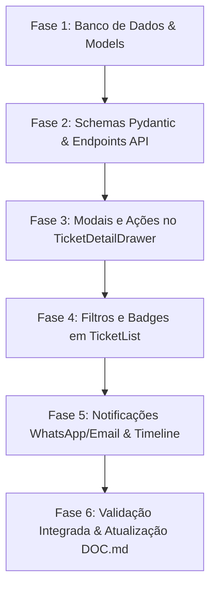

# Plano de Implementação: Níveis de Atendimento (N1, N2, N3), Assumir, Transferir e Escalar Chamados
## Alinhamento com Governança ITIL 4 e COBIT 2019 (DSS02)

> **Status:** Aprovado para Implementação  
> **Sistema:** TIHFSA — Helpdesk & Gestão de TI (Hotel Fasano Salvador)  
> **Frameworks de Referência:** 
> - **ITIL 4 (Prática de Gerenciamento de Incidentes & Service Desk)**: Foco em FCR (First Contact Resolution), Escalação Funcional (Técnica) vs Escalação Hierárquica (Gerencial), Gestão de Custódia/Propriedade (Ownership) e SLA de Primeira Resposta.
> - **COBIT 2019 (Domínio DSS02 - Gerenciar Solicitações de Serviço e Incidentes)**:
>   - *DSS02.01*: Esquema estruturado de classificação e níveis de atendimento.
>   - *DSS02.04*: Alocação clara de responsabilidade técnica sem chamados órfãos.
>   - *DSS02.05*: Procedimentos de escalação documentados e rastreáveis.
>   - *DSS02.07*: Trilha de auditoria completa e não-repúdio de todas as transferências e transições.

---

## 1. Visão Geral da Arquitetura e Regras de Negócio

### 1.1 Definição dos Níveis de Suporte (Support Tiers)

| Nível | Identificação Visual | Escopo Operacional | Exemplos no Fasano | Atribuição Automática Padrão |
| :--- | :--- | :--- | :--- | :--- |
| **N1** | 🟦 **Azul** (`#0284c7`) | **Service Desk / Suporte Básico** | Senhas, impressoras, periféricos, e-mail, TV quartos, dúvidas gerais | Novos chamados de usuários via portal/WhatsApp |
| **N2** | 🟪 **Roxo** (`#7e22ce`) | **Suporte Avançado / Field Services** | Hardware, SO Windows, redes locais, telefonia IP, Micros, Opera PMS | Chamados com triagem N1 ou reaberturas |
| **N3** | 🟥 **Vermelho/Âmbar** (`#e11d48`) | **Infraestrutura, Redes & Servidores** | Servidores FASSA, Veritas Backup Exec, Switches Cisco/UniFi, Firewall | Auto-Alertas Zabbix, NOC e Veritas Backup Exec |

---

### 1.2 Regras das Ações Operacionais

1. **Assumir Chamado (Take Ownership)**:
   - **Quem pode executar**: Qualquer técnico ou administrador autenticado.
   - **Comportamento**: Atribui o chamado imediatamente ao usuário logado (`technician_id = current_user.id`).
   - **Regra de Transição**: Se o status do chamado for `"Novo"`, avança automaticamente para `"Em Andamento"`.
   - **Auditoria**: Registra interação de sistema na timeline: `📌 O técnico [Nome] assumiu o atendimento do chamado.`

2. **Transferir Chamado (Lateral / Reatribuição)**:
   - **Quem pode executar**: O técnico responsável atual, qualquer gestor ou administrador.
   - **Parâmetros**: `novo_tecnico_id` (obrigatório) e `motivo_transferencia` (obrigatório).
   - **Comportamento**: Atualiza `technician_id` para o novo técnico selecionado.
   - **Auditoria**: Registra na timeline: `🔄 Chamado transferido de [Técnico A] para [Técnico B]. Motivo: [Justificativa]`.
   - **Notificação**: Notifica o novo técnico por WhatsApp e e-mail corporativo.

3. **Escalar Chamado (Vertical N1 → N2 → N3)**:
   - **Quem pode executar**: Técnico responsável, gestores e administradores.
   - **Parâmetros**: `nivel_destino` (`N1`, `N2` ou `N3`), `novo_tecnico_id` (opcional) e `motivo_escalacao` (diagnóstico prévio do que foi feito).
   - **Comportamento**:
     - Atualiza `support_level = nivel_destino`.
     - Se nenhum técnico for escolhido, limpa `technician_id = None` para que o chamado entre na **Fila Geral do Nível** para os especialistas assumirem.
   - **Auditoria**: Registra na timeline com destaque: `🚀 Chamado escalado de [N1] para [N2] por [Nome]. Diagnóstico/Motivo: [Texto]`.
   - **Notificação**: Dispara alerta imediato no grupo da TI informando que há um chamado escalado aguardando atendimento.

---

## 2. Detalhamento das Alterações Técnicas

### 2.1 Backend — Banco de Dados & Modelos (SQLAlchemy)

- **[backend/app/models/ticket.py](file:///c:/Users/diego.reis/Documents/DEV/TIHFSA/backend/app/models/ticket.py)**:
  - Adicionar Enum e Colunas no modelo `Ticket`:
    ```python
    class SupportLevel(str, enum.Enum):
        N1 = "N1"
        N2 = "N2"
        N3 = "N3"

    # Novas colunas na tabela tickets:
    support_level = Column(Enum(SupportLevel), default=SupportLevel.N1, nullable=False, index=True)
    escalated_at = Column(DateTime(timezone=True), nullable=True)
    escalated_by_id = Column(Integer, ForeignKey("users.id"), nullable=True)
    escalation_reason = Column(Text, nullable=True)
    transferred_at = Column(DateTime(timezone=True), nullable=True)
    transferred_by_id = Column(Integer, ForeignKey("users.id"), nullable=True)
    transfer_reason = Column(Text, nullable=True)
    ```

- **[backend/app/models/user.py](file:///c:/Users/diego.reis/Documents/DEV/TIHFSA/backend/app/models/user.py)**:
  - Adicionar competência do técnico:
    ```python
    support_level = Column(String(10), default="N1", nullable=True) # N1, N2, N3
    ```

- **[backend/app/models/ticket_interaction.py](file:///c:/Users/diego.reis/Documents/DEV/TIHFSA/backend/app/models/ticket_interaction.py)**:
  - Adicionar tipo de interação para estilização rica na timeline:
    ```python
    interaction_type = Column(String(30), default="comment", nullable=False)
    # Valores: "comment", "system", "take", "transfer", "escalate", "solution", "reopen"
    ```

---

### 2.2 Backend — Schemas & DTOs (Pydantic)

- **[backend/app/schemas/ticket.py](file:///c:/Users/diego.reis/Documents/DEV/TIHFSA/backend/app/schemas/ticket.py)**:
  - Atualizar `TicketResponse` e `TicketDetail` com `support_level`, `escalated_at`, `transferred_at`, etc.
  - Novos schemas:
    ```python
    class TicketTake(BaseModel):
        pass # Não requer payload, usa current_user.id

    class TicketTransfer(BaseModel):
        target_technician_id: int
        reason: str

    class TicketEscalate(BaseModel):
        target_level: str # "N1", "N2", "N3"
        target_technician_id: int | None = None
        reason: str
    ```

---

### 2.3 Backend — Endpoints da API (`/api/v1/tickets`)

- **[backend/app/routers/tickets.py](file:///c:/Users/diego.reis/Documents/DEV/TIHFSA/backend/app/routers/tickets.py)**:
  1. `POST /{id}/take` → Executa "Assumir Chamado", muda status para `Em Andamento` se `Novo`, cria interação e notifica.
  2. `POST /{id}/transfer` → Executa "Transferir Chamado", valida técnico ativo, audita transferência e notifica.
  3. `POST /{id}/escalate` → Executa "Escalar Chamado", altera nível, desassocia técnico se for para a fila do nível, gera evento de timeline e alerta a equipe.
  4. `GET /` → Adicionar query params:
     - `support_level: str | None = None` (Filtrar por N1, N2 ou N3).
     - `unassigned: bool | None = None` (Filtrar chamados sem técnico atribuído).
  5. `GET /stats` → Adicionar contadores de chamados por nível (`n1_count`, `n2_count`, `n3_count`).

---

### 2.4 Frontend — Telas e Componentes

1. **Painel Lateral de Detalhes ([TicketDetailDrawer.jsx](file:///c:/Users/diego.reis/Documents/DEV/TIHFSA/frontend/src/components/admin/TicketDetailDrawer.jsx))**:
   - **Badge de Nível no Topo**: Exibição destacada ao lado do ID e Status (`N1`, `N2` ou `N3`).
   - **Barra de Ações Rápidas do Técnico**:
     - Se o chamado **não tem técnico**: Botão verde/azul destacado `🖐️ Assumir Chamado`.
     - Se o chamado **já tem técnico**:
       - Botão `🔄 Transferir` → Abre modal de seleção de técnico e justificativa.
       - Botão `🚀 Escalar` → Abre modal com seleção de nível (N1, N2, N3), técnico opcional e motivo.
   - **Timeline Formatada**: Eventos de assunção, transferência e escalação exibidos com cards de auditoria coloridos e ícones temáticos.

2. **Tela Completa do Chamado ([TicketDetail.jsx](file:///c:/Users/diego.reis/Documents/DEV/TIHFSA/frontend/src/pages/admin/TicketDetail.jsx))**:
   - Mesmas ações operacionais refletidas na página completa de atendimento.

3. **Lista de Chamados ([TicketList.jsx](file:///c:/Users/diego.reis/Documents/DEV/TIHFSA/frontend/src/pages/admin/TicketList.jsx))**:
   - **Filtro de Nível**: Dropdown `Nível: Todos | N1 (Operacional) | N2 (Avançado) | N3 (Especialistas)`.
   - **Aba / Filtro Rápido "Na Fila (Sem Técnico)"**: Para que técnicos identifiquem chamados disponíveis para assunção imediata.
   - **Badges de Nível nas Linhas e Cards Mobile**: Tag compacta `N1`, `N2`, `N3` em cada chamado.

4. **Novo Chamado ([NewTicket.jsx](file:///c:/Users/diego.reis/Documents/DEV/TIHFSA/frontend/src/pages/admin/NewTicket.jsx))**:
   - Seleção de nível inicial (default: N1; alertas de servidor/NOC: N3).

---

## 3. Plano de Execução Passo a Passo (Ordem de Implementação)



- **Passo 1**: Migração segura do SQLite/PostgreSQL com colunas padrão (`support_level`, etc.) sem quebrar chamados existentes (todos os chamados legados receberão `N1` automaticamente).
- **Passo 2**: Criação dos endpoints `/take`, `/transfer` e `/escalate` em `tickets.py` com testes de permissão.
- **Passo 3**: Implementação dos modais de Transferência e Escalação no `TicketDetailDrawer.jsx` e `TicketDetail.jsx`.
- **Passo 4**: Adição de filtros por nível e visão "Na Fila" em `TicketList.jsx`.
- **Passo 5**: Estilização visual na Timeline de interações e disparo de notificações automáticas.
- **Passo 6**: Verificação em PowerShell e atualização completa de [DOC.md](file:///c:/Users/diego.reis/Documents/DEV/TIHFSA/DOC.md).

---

## 3. Configuração de Técnicos por Nível (N1, N2, N3)

- **Onde Configurar**: No painel administrativo em **Configurações ⚙️ ➔ Usuários / Colaboradores**, clicando em **"Editar Usuário"**.
- **Seletor de Nível ITIL 4**:
  - **N1 — Service Desk**: Triagem inicial, atendimento operacional rápido, dúvidas de usuários e chamados corriqueiros.
  - **N2 — Suporte Avançado / Field & Sistemas**: Especialista em sistemas corporativos (Opera PMS, CMNET, Micros) e diagnósticos aprofundados de hardware/software.
  - **N3 — Engenharia de Redes & NOC**: Infraestrutura crítica, firewall Fortinet, switches core, servidores físicos/virtuais, storage e telecom.
- **Roteamento de Chamados**:
  - Novos chamados abertos por usuários ou apartamentos entram por padrão no **N1 (Service Desk)**.
  - Alertas automáticos do NOC (Zabbix/UniFi) entram catalogados diretamente no **N3 (Infraestrutura)**.
  - Técnicos N1 escalam funcionalmente para N2 ou N3 com diagnóstico prévio e justificativa técnica auditada.
  - Técnicos podem transferir para outro colega do mesmo nível com justificativa registrada.
  - No dropdown de seleção de técnicos (Transferência e Escalação), o nível de cada especialista é exibido explicitamente (`Nome • Nível N1/N2/N3 (Cargo)`).

---

## 4. Ações em Massa na Fila de Chamados (Assumir & Transferir em Lote)

Na tela principal de chamados (`/admin/tickets`), a barra flutuante de ações em massa foi expandida para suportar operações de custódia técnica:
- **⚡ Assumir ({N})**: Com 1 clique de confirmação, o técnico autenticado assume a custódia imediata de todos os chamados marcados. Se o status for `Novo`, avança para `Em Andamento`, registra o SLA de primeira resposta (`first_response_at`) e gera interação de custódia na timeline de cada chamado (`interaction_type="take"`).
- **🔄 Transferir ({N})**: Abre modal de transferência em massa permitindo selecionar o técnico de destino (com exibição do nível de atendimento de cada especialista) e preencher a justificativa técnica obrigatória. Cada chamado recebe o registro de transferência auditado (`interaction_type="transfer"`) e o novo técnico é notificado via WhatsApp e e-mail corporativo.
- **📋 Status ({N})**: Modal existente para transição de status em massa com motivo obrigatório para encerramento.


